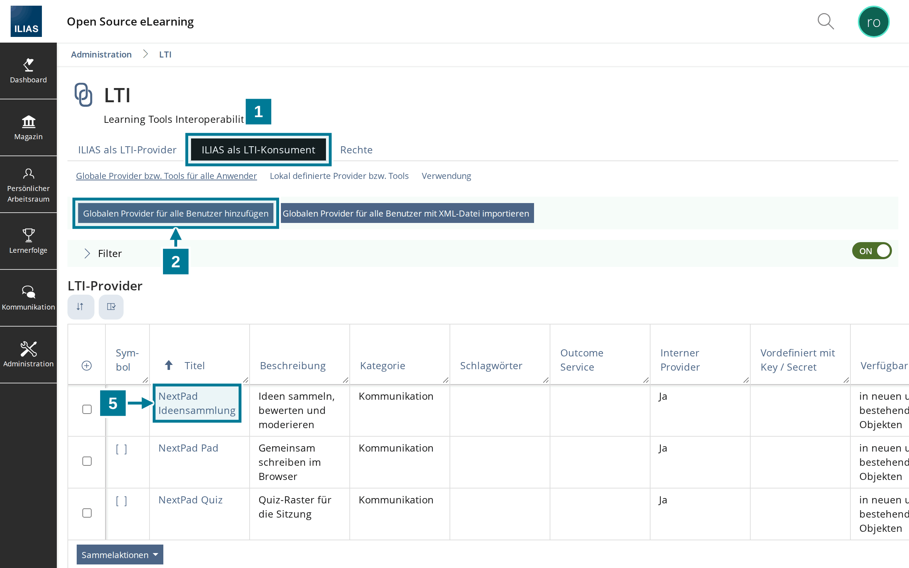
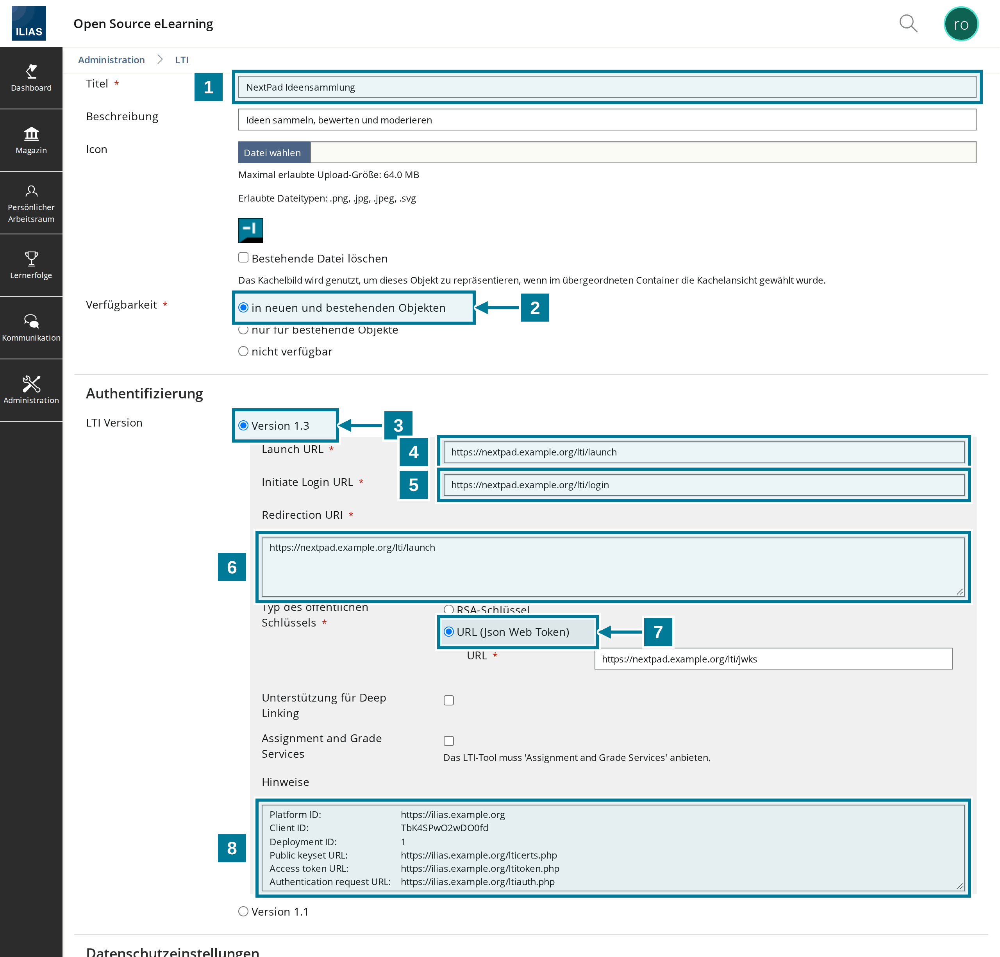
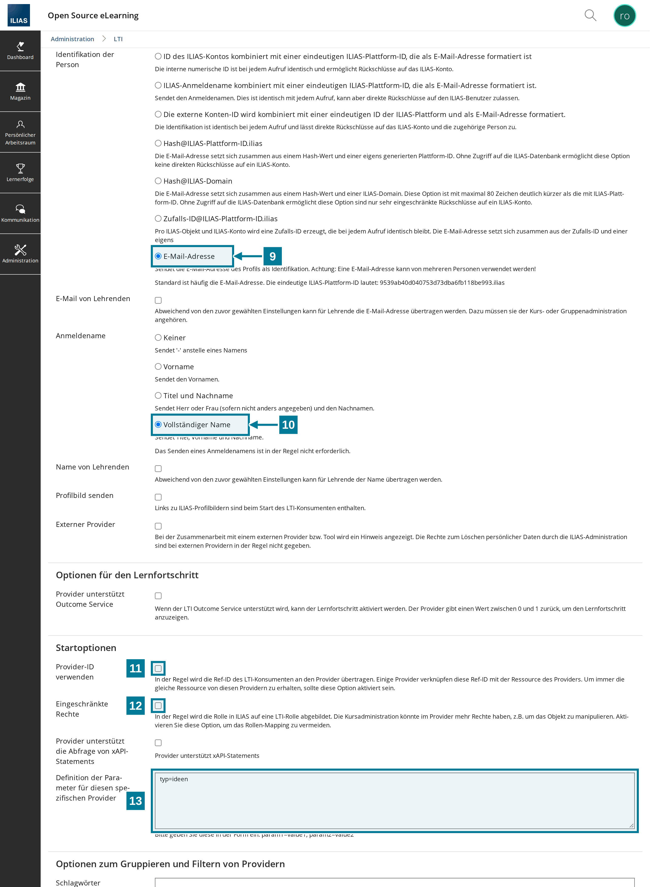

# Werkzeug in ILIAS eintragen

<aside class="np-kasten np-ziel" aria-label="Worum es geht">
<p class="np-kasten-titel">Worum es geht</p>

- NextPad als globalen LTI-Provider nach LTI 1.3 in ILIAS eintragen
- Pad, Ideensammlung und Quiz als eigene Werkzeuge anbieten
- ILIAS in der Konfiguration von NextPad bekannt machen

</aside>

Diese Anleitung richtet sich an die Administration der ILIAS-Installation und an alle, die NextPad betreiben. Beide Seiten brauchen HTTPS. Im Folgenden steht `https://nextpad.example.org` für die Adresse von NextPad und `https://ilias.example.org` für die von ILIAS.

Für jede Art entsteht ein eigenes Werkzeug. Lehrende wählen dann einfach **NextPad Ideensammlung**, **NextPad Quiz** oder **NextPad Pad** und müssen nichts eintippen.

## Schritte in ILIAS

<figure class="np-bild">

<figcaption>Unter „ILIAS als LTI-Konsument“ entsteht je Art ein globaler Provider.</figcaption>
</figure>

1. **Administration › ILIAS erweitern › LTI** öffnen und den Reiter **ILIAS als LTI-Konsument** wählen.
2. **Globalen Provider für alle Benutzer hinzufügen** wählen.
3. Das Formular nach der Tabelle unten ausfüllen und speichern.
4. Schritt 2 und 3 für die anderen Arten wiederholen, mit eigenem Titel und eigenem Wert für `typ`.
5. Einen gespeicherten Provider über seinen Titel wieder öffnen. Im Feld **Hinweise** stehen jetzt die Angaben für NextPad.

## Die Felder

<figure class="np-bild">

<figcaption>Oberer Teil: Adressen von NextPad und die Hinweise für NextPad.</figcaption>
</figure>

<figure class="np-bild">

<figcaption>Unterer Teil: Name und Mailadresse, Startoptionen und der Parameter.</figcaption>
</figure>

| Nr. | Feld | Wert |
|---|---|---|
| 1 | Titel | so, wie Lehrende es in der Liste lesen sollen, etwa `NextPad Ideensammlung` |
| 2 | Verfügbarkeit | in neuen und bestehenden Objekten |
| 3 | LTI Version | Version 1.3 |
| 4 | Launch URL | `https://nextpad.example.org/lti/launch` |
| 5 | Initiate Login URL | `https://nextpad.example.org/lti/login` |
| 6 | Redirection URI | `https://nextpad.example.org/lti/launch` |
| 7 | Typ des öffentlichen Schlüssels | URL (Json Web Token), darunter `https://nextpad.example.org/lti/jwks` |
| 8 | Hinweise | erscheint erst nach dem Speichern; die Angaben gehören in die Konfiguration von NextPad |
| 9 | Identifikation der Person | E-Mail-Adresse |
| 10 | Anmeldename | Vollständiger Name |
| 11 | Provider-ID verwenden | nicht ankreuzen |
| 12 | Eingeschränkte Rechte | nicht ankreuzen |
| 13 | Definition der Parameter | `typ=ideen`, für das Quiz `typ=quiz`, für das Pad `typ=pad` |

Die Parameterwerte `ideen`, `quiz` und `pad` bleiben in jeder Sprache gleich. Als **Icon** passt das NextPad-Zeichen, als **Kategorie** „Kommunikation“. Beides ist freiwillig.

Mit **Provider-ID verwenden** würden sich alle Objekte eines Kurses eine Sammlung teilen. Mit **Eingeschränkte Rechte** käme ILIAS ohne Rollen bei NextPad an, und niemand könnte moderieren.

## Schritt in NextPad

NextPad nimmt nur Starts von Plattformen an, die in der Plattformdatei `lti-platforms.json` stehen. Jedes Werkzeug bekommt dort einen Eintrag mit den Angaben aus dem Feld **Hinweise**:

```json
{
  "name": "ilias-ideen",
  "label": "Mit ILIAS anmelden",
  "issuer": "https://ilias.example.org",
  "client_id": "AbC123xYz456QrS",
  "deployment_ids": ["1"],
  "auth_url": "https://ilias.example.org/ltiauth.php",
  "jwks_url": "https://ilias.example.org/lticerts.php"
}
```

`issuer` ist die Platform ID, `auth_url` die Authentication request URL und `jwks_url` die Public keyset URL. Client ID und Deployment ID unterscheiden sich je Werkzeug. Die [Server-Dokumentation](https://github.com/NextPad/NextPad/blob/main/server/README.de.md) beschreibt alle Felder der Datei. Nach einer Änderung der Datei muss NextPad neu starten.

## Gut zu wissen

- ILIAS gibt Namen und Sprache an NextPad weiter. Die Mailadresse braucht NextPad für die Nachricht vor dem Löschen eigener freier Pads und um Admins aus `NEXTPAD_ADMINS` zu erkennen. Die anderen Arten der Identifikation schicken eine Ersatzadresse wie `…@….ilias`, an die keine Mail ankommt.
- Moderieren dürfen Kursadministration und Kursbetreuung, in Gruppen die Gruppenadministration, außerdem die ILIAS-Administration. Alle anderen machen mit. Liegt das Objekt in einer Gruppe, zählen die Rollen der Gruppe, nicht die des Kurses.
- Im neuen Fenster hat NextPad die volle Breite, und die Leinwand lässt sich leichter auf den Beamer ziehen.
- Wechselt ILIAS seine Schlüssel, holt NextPad die neuen über `jwks_url` von selbst.
