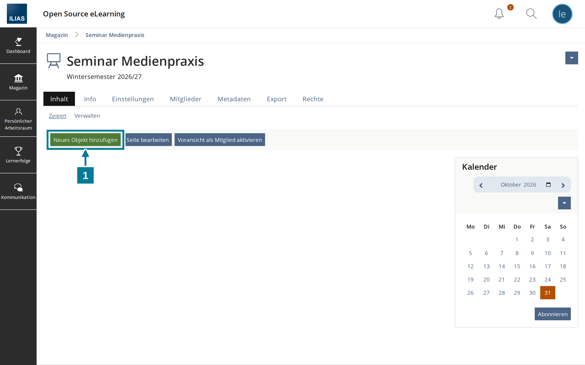
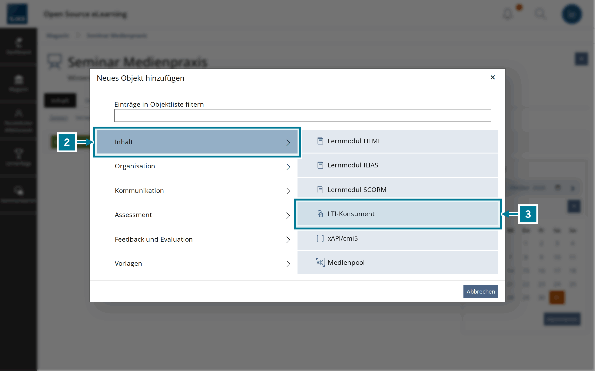
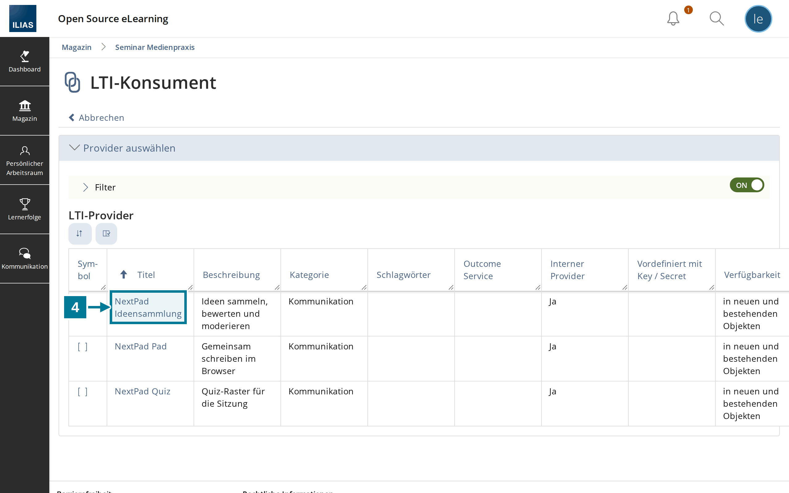
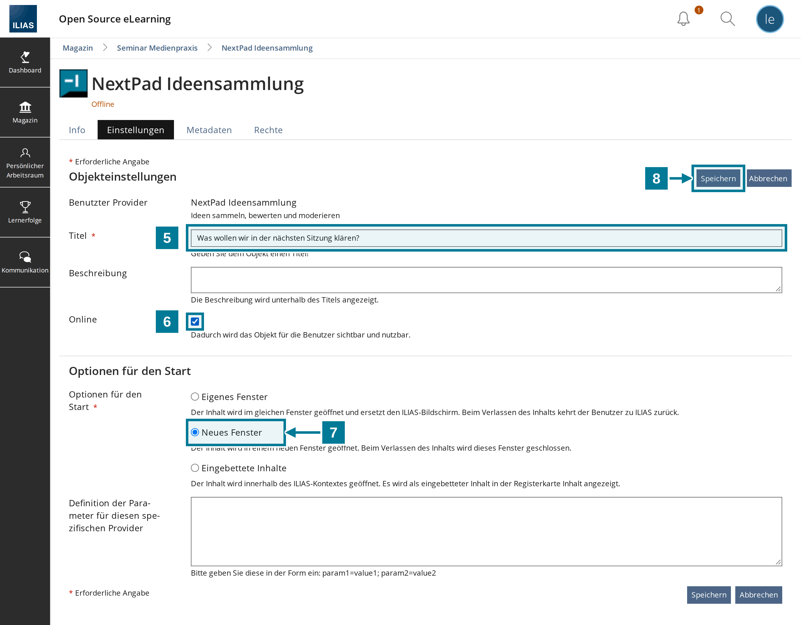
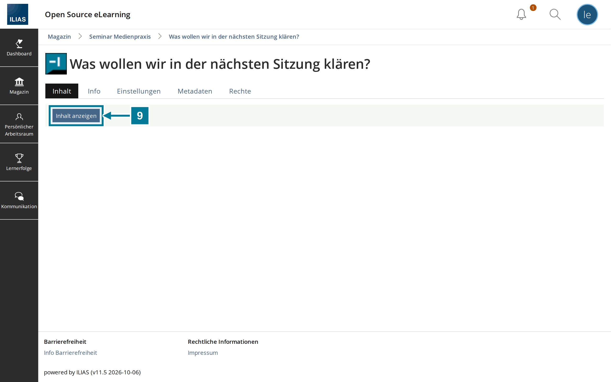
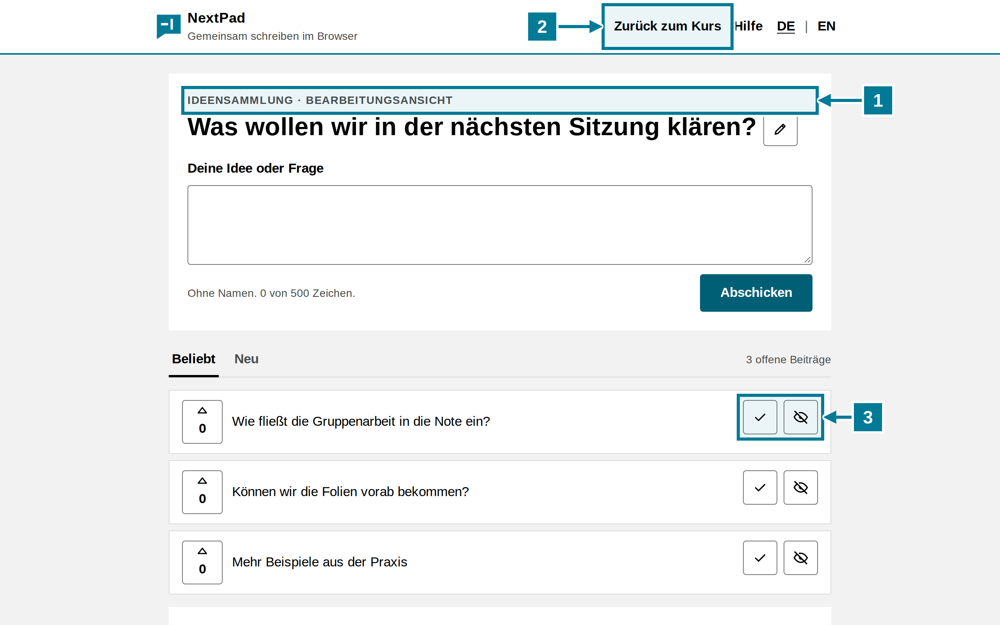
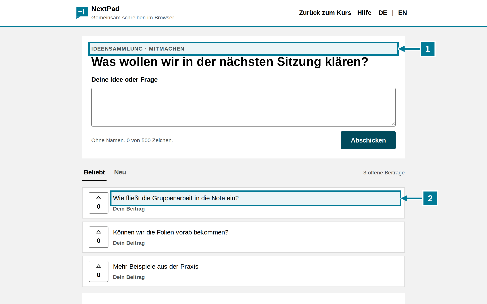

# Objekt im Kurs anlegen

<aside class="np-kasten np-ziel" aria-label="Worum es geht">
<p class="np-kasten-titel">Worum es geht</p>

- eine NextPad-Ideensammlung als Objekt in den Kurs legen
- die Frage über den Titel des Objekts festlegen
- das Objekt starten und moderieren

</aside>

Voraussetzung: Die Administration hat die NextPad-Werkzeuge in ILIAS eingetragen. Fehlen sie in der Auswahl, hilft die Anleitung [Werkzeug in ILIAS eintragen](einrichten.md).

## Schritte

<figure class="np-bild">

<figcaption>Im Kurs ein neues Objekt hinzufügen.</figcaption>
</figure>

1. Im Kurs **Neues Objekt hinzufügen** wählen.

<figure class="np-bild">

<figcaption>NextPad steckt im Objekttyp „LTI-Konsument“.</figcaption>
</figure>

<ol start="2">
<li>Links die Gruppe <strong>Inhalt</strong> wählen.</li>
<li>Rechts <strong>LTI-Konsument</strong> wählen.</li>
</ol>

<figure class="np-bild">

<figcaption>Die Liste zeigt die drei NextPad-Werkzeuge.</figcaption>
</figure>

<ol start="4">
<li><strong>NextPad Ideensammlung</strong> anklicken. Für ein Quiz gilt dasselbe mit <strong>NextPad Quiz</strong>, für einen gemeinsamen Text mit <strong>NextPad Pad</strong>. ILIAS legt das Objekt sofort an und öffnet seine Einstellungen.</li>
</ol>

<figure class="np-bild">

<figcaption>Der Titel wird zur Frage der Sammlung, „Online“ macht das Objekt sichtbar.</figcaption>
</figure>

<ol start="5">
<li>Unter <strong>Titel</strong> die Frage der Sammlung eintragen. NextPad übernimmt höchstens 200 Zeichen.</li>
<li><strong>Online</strong> ankreuzen. Neue Objekte sind sonst für Kursmitglieder unsichtbar.</li>
<li>Bei <strong>Neues Fenster</strong> bleiben.</li>
<li><strong>Speichern</strong> wählen.</li>
</ol>

<figure class="np-bild">

<figcaption>„Inhalt anzeigen“ öffnet NextPad in einem neuen Fenster.</figcaption>
</figure>

<ol start="9">
<li>Im Kurs das Objekt anklicken und <strong>Inhalt anzeigen</strong> wählen. NextPad öffnet sich in einem neuen Fenster.</li>
</ol>

## Was die Leitung sieht

<figure class="np-bild">

<figcaption>Die Leitung sieht die Bearbeitungsansicht mit den Knöpfen zum Moderieren.</figcaption>
</figure>

1. Über der Frage steht **Bearbeitungsansicht**. Moderieren dürfen Kursadministration und Kursbetreuung.
2. **Zurück zum Kurs** führt zur Kursseite in ILIAS.
3. Mit dem Haken wird ein Beitrag erledigt, mit dem Auge ausgeblendet. Mehr dazu in [Sammeln und moderieren](../ideen/sammeln.md).

## Was Studierende sehen

<figure class="np-bild">

<figcaption>Kursmitglieder sehen dieselbe Sammlung zum Mitmachen, ohne Moderationsknöpfe.</figcaption>
</figure>

1. Über der Frage steht **Mitmachen**.
2. Eigene Beiträge tragen den Hinweis „Dein Beitrag“. Die anderen sehen sie ohne Namen.

## Gut zu wissen

- Die Frage übernimmt NextPad beim ersten Start des Objekts. Wird der Titel danach in ILIAS geändert, bleibt die Frage. Sie lässt sich in NextPad mit dem Stift ändern.
- Der QR-Code auf der Leinwand führt zum Objekt in ILIAS. Wer ihn scannt, meldet sich in ILIAS an und wählt dort **Inhalt anzeigen**. Gäste ohne ILIAS-Konto kommen nicht hinein.
- Jedes Objekt hat seine eigene Sammlung. Eine Kopie des Objekts beginnt leer.
- Aus NextPad heraus lässt sich eine Kurs-Sammlung nicht löschen. Sie folgt auch keiner Löschfrist von NextPad.

## Selbst ausprobieren

Im eigenen Kurs eine Ideensammlung mit der Frage aus den Bildern anlegen und starten. Dann mit einem Testkonto als Kursmitglied einen Beitrag schreiben und beide Ansichten vergleichen. Die Voransicht als Mitglied reicht dafür nicht: Wer das Objekt einmal als Leitung gestartet hat, bleibt in NextPad Leitung.

```text
Was wollen wir in der nächsten Sitzung klären?
```
