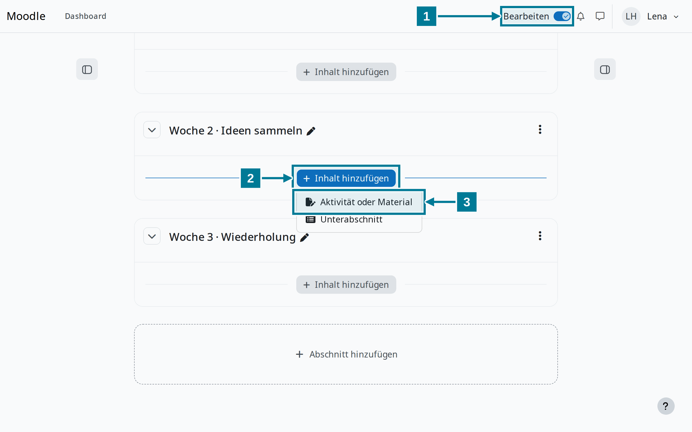
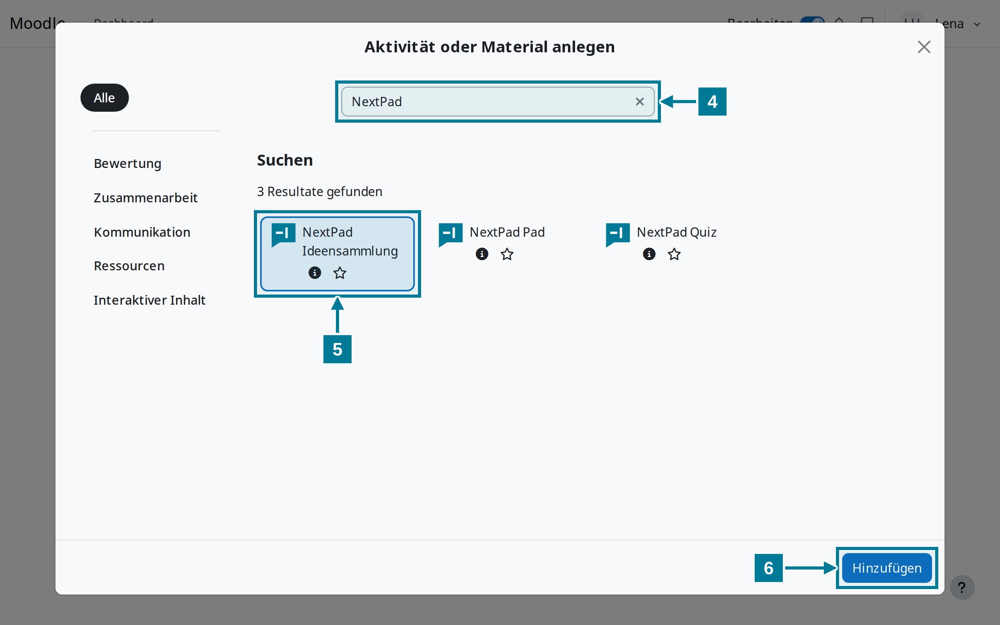
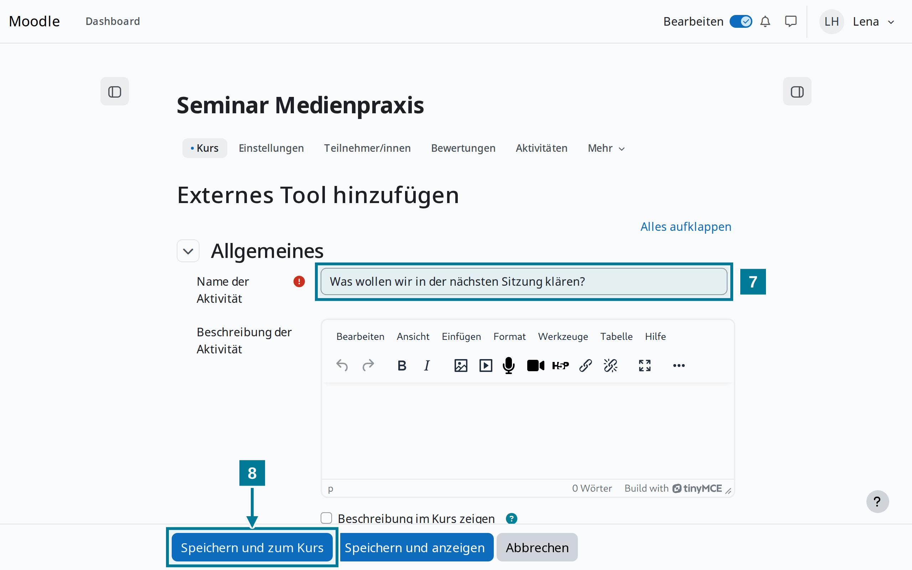
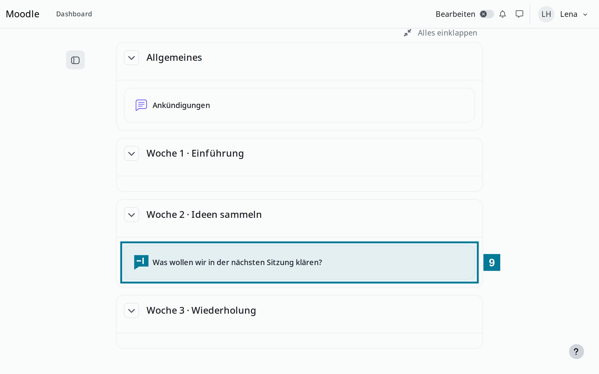
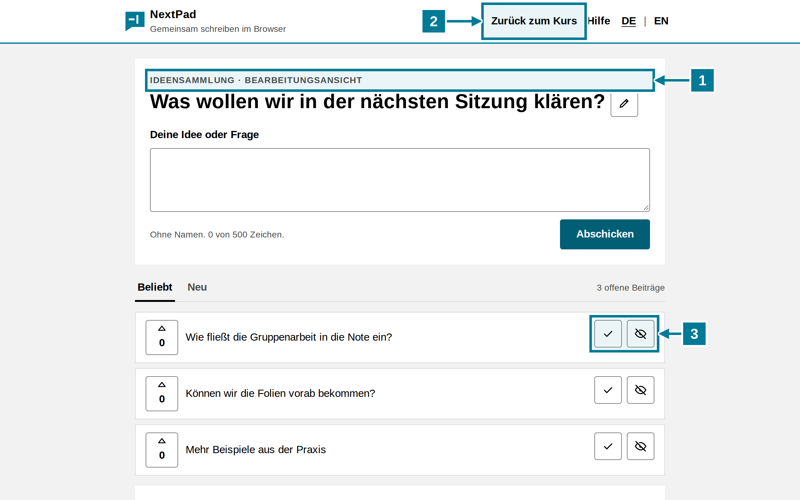
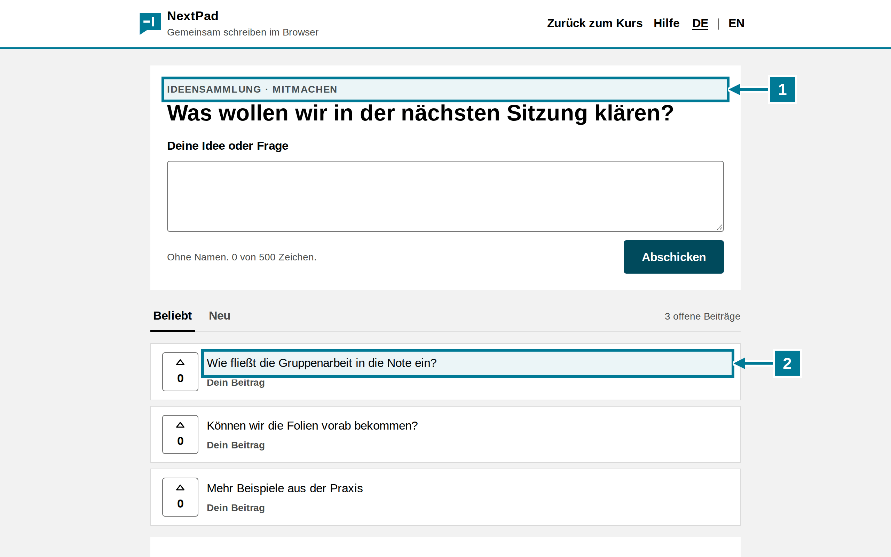

# Aktivität im Kurs anlegen

<aside class="np-kasten np-ziel" aria-label="Worum es geht">
<p class="np-kasten-titel">Worum es geht</p>

- eine NextPad-Ideensammlung als Aktivität in den Kurs legen
- die Frage über den Namen der Aktivität festlegen
- die Aktivität starten und moderieren

</aside>

Voraussetzung: Die Administration hat die NextPad-Werkzeuge in Moodle eingetragen. Fehlen sie in der Aktivitätenauswahl, hilft die Anleitung [Werkzeug in Moodle eintragen](einrichten.md).

## Schritte

<figure class="np-bild">

<figcaption>Bearbeiten einschalten und im passenden Abschnitt eine Aktivität hinzufügen.</figcaption>
</figure>

1. Im Kurs oben rechts **Bearbeiten** einschalten.
2. Im passenden Abschnitt **Inhalt hinzufügen** wählen.
3. **Aktivität oder Material** wählen.

<figure class="np-bild">

<figcaption>Die Suche zeigt die drei NextPad-Werkzeuge.</figcaption>
</figure>

<ol start="4">
<li>In der Suche <strong>NextPad</strong> eingeben.</li>
<li><strong>NextPad Ideensammlung</strong> wählen. Für ein Quiz gilt dasselbe mit <strong>NextPad Quiz</strong>, für einen gemeinsamen Text mit <strong>NextPad Pad</strong>.</li>
<li><strong>Hinzufügen</strong> wählen.</li>
</ol>

<figure class="np-bild">

<figcaption>Der Name der Aktivität wird zur Frage der Sammlung.</figcaption>
</figure>

<ol start="7">
<li>Unter <strong>Name der Aktivität</strong> die Frage der Sammlung eintragen. NextPad übernimmt höchstens 200 Zeichen.</li>
<li><strong>Speichern und zum Kurs</strong> wählen.</li>
</ol>

<figure class="np-bild">

<figcaption>Die Aktivität steht im Kurs und öffnet NextPad in einem neuen Fenster.</figcaption>
</figure>

<ol start="9">
<li>Die Aktivität im Kurs anklicken. NextPad öffnet sich in einem neuen Fenster.</li>
</ol>

## Was die Leitung sieht

<figure class="np-bild">

<figcaption>Die Leitung sieht die Bearbeitungsansicht mit den Knöpfen zum Moderieren.</figcaption>
</figure>

1. Über der Frage steht **Bearbeitungsansicht**. Moderieren dürfen alle Lehrenden des Kurses.
2. **Zurück zum Kurs** führt zur Kursseite in Moodle.
3. Mit dem Haken wird ein Beitrag erledigt, mit dem Auge ausgeblendet. Mehr dazu in [Sammeln und moderieren](../ideen/sammeln.md).

## Was Studierende sehen

<figure class="np-bild">

<figcaption>Studierende sehen dieselbe Sammlung zum Mitmachen, ohne Moderationsknöpfe.</figcaption>
</figure>

1. Über der Frage steht **Mitmachen**.
2. Eigene Beiträge tragen den Hinweis „Dein Beitrag“. Die anderen sehen sie ohne Namen.

## Gut zu wissen

- Die Frage übernimmt NextPad beim ersten Start der Aktivität. Wird der Name danach in Moodle geändert, bleibt die Frage. Sie lässt sich in NextPad mit dem Stift ändern.
- Der QR-Code auf der Leinwand führt zur Aktivität in Moodle. Wer ihn scannt, meldet sich in Moodle an und landet dann in der Sammlung. Gäste ohne Moodle-Konto kommen nicht hinein.
- Jede Aktivität hat ihre eigene Sammlung. Eine Kopie der Aktivität in einem anderen Kurs beginnt leer.
- Aus NextPad heraus lässt sich eine Kurs-Sammlung nicht löschen. Sie folgt auch keiner Löschfrist von NextPad.

## Selbst ausprobieren

Im eigenen Kurs eine Ideensammlung mit der Frage aus den Bildern anlegen und starten. Dann mit einem studentischen Testzugang einen Beitrag schreiben und beide Ansichten vergleichen. Der Rollenwechsel in Moodle reicht dafür nicht: Wer die Aktivität einmal als Leitung gestartet hat, bleibt in NextPad Leitung.

```text
Was wollen wir in der nächsten Sitzung klären?
```
