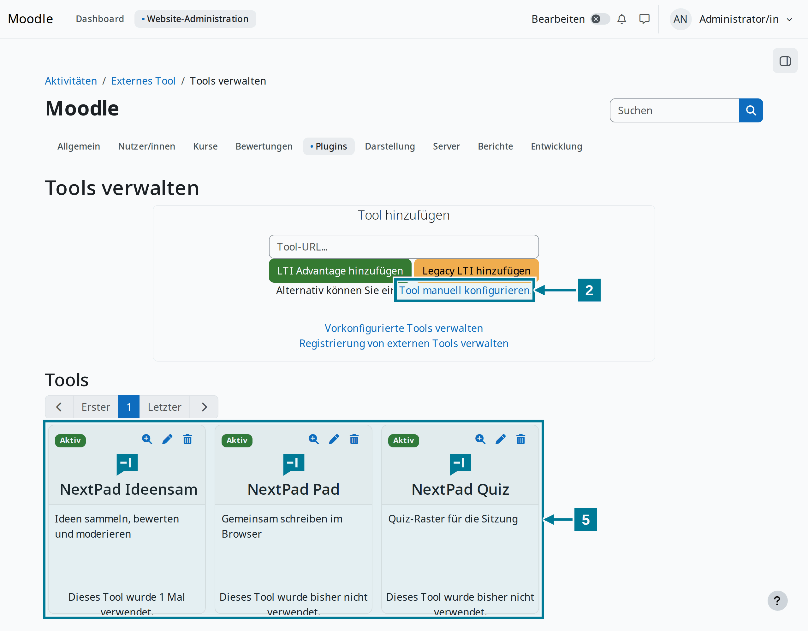
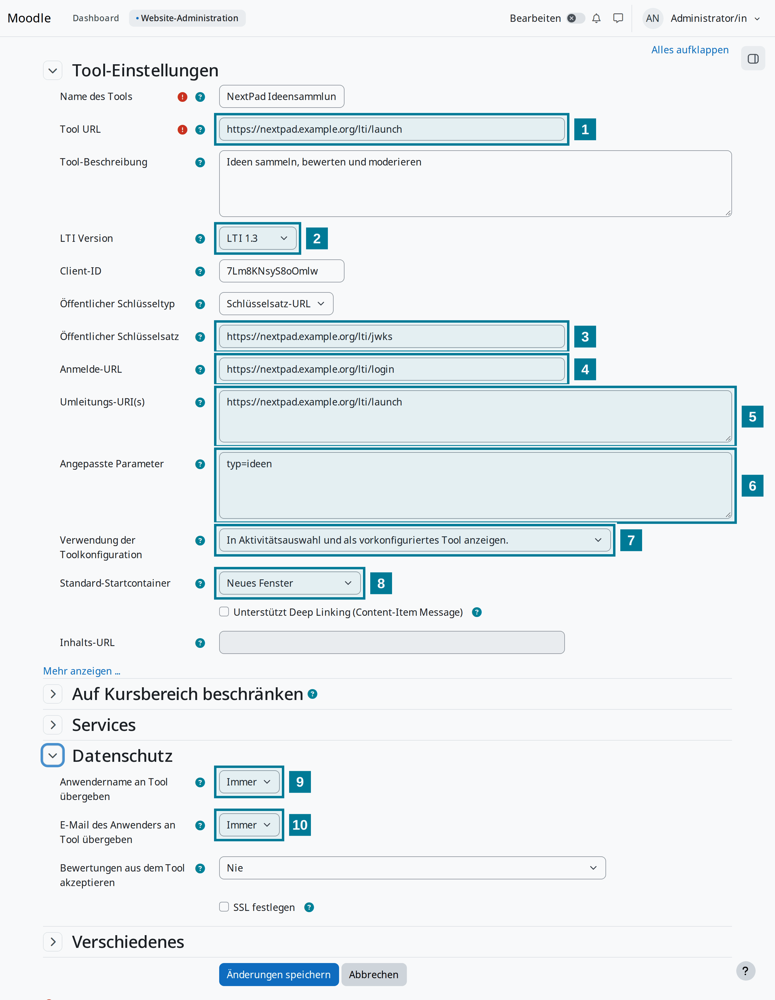

# Werkzeug in Moodle eintragen

<aside class="np-kasten np-ziel" aria-label="Worum es geht">

Worum es geht

- NextPad als externes Tool nach LTI 1.3 in Moodle eintragen
- Pad, Ideensammlung und Quiz als eigene Werkzeuge in der Aktivitätenauswahl anbieten
- Moodle in der Konfiguration von NextPad bekannt machen

</aside>

Diese Anleitung richtet sich an die Administration der Moodle und an alle, die NextPad betreiben. Beide Seiten brauchen HTTPS. Im Folgenden steht `https://nextpad.example.org` für die Adresse von NextPad.

Für jede Art entsteht ein eigenes Werkzeug. Lehrende wählen dann in der Aktivitätenauswahl einfach **NextPad Ideensammlung**, **NextPad Quiz** oder **NextPad Pad** und müssen nichts eintippen.

## Schritte in Moodle

<figure class="np-bild">

<figcaption>Unter „Tools verwalten“ entsteht je Art ein Werkzeug.</figcaption>
</figure>

1. **Website-Administration › Plugins › Aktivitäten › Externes Tool › Tools verwalten** öffnen.
2. **Tool manuell konfigurieren** wählen.
3. Das Formular nach der Tabelle unten ausfüllen und **Änderungen speichern** wählen.
4. Schritt 2 und 3 für die anderen Arten wiederholen, mit eigenem Namen und eigenem Wert für `typ`.
5. Die Werkzeuge erscheinen als Karten unter **Tools**. Die Lupe auf einer Karte zeigt Client-ID und Deployment-ID. Beide gehören in die Konfiguration von NextPad.

## Die Felder

<figure class="np-bild">

<figcaption>Die Ziffern im Bild entsprechen den Zeilen der Tabelle.</figcaption>
</figure>

| Nr. | Feld | Wert |
|---|---|---|
| | Name des Tools | so, wie Lehrende es in der Auswahl lesen sollen, etwa `NextPad Ideensammlung` |
| 1 | Tool URL | `https://nextpad.example.org/lti/launch` |
| 2 | LTI Version | LTI 1.3 |
| 3 | Öffentlicher Schlüsselsatz | `https://nextpad.example.org/lti/jwks` (Schlüsseltyp: Schlüsselsatz-URL) |
| 4 | Anmelde-URL | `https://nextpad.example.org/lti/login` |
| 5 | Umleitungs-URI(s) | `https://nextpad.example.org/lti/launch` |
| 6 | Angepasste Parameter | `typ=ideen`, für das Quiz `typ=quiz`, für das Pad `typ=pad` |
| 7 | Verwendung der Toolkonfiguration | In Aktivitätsauswahl und als vorkonfiguriertes Tool anzeigen |
| 8 | Standard-Startcontainer | Neues Fenster |
| 9 | Anwendername an Tool übergeben | Immer |
| 10 | E-Mail des Anwenders an Tool übergeben | Immer |

Unter **Mehr anzeigen** lässt sich als **Icon URL** `https://nextpad.example.org/static/logo.svg` eintragen. Dann zeigt die Aktivitätenauswahl das NextPad-Zeichen statt eines Puzzleteils.

## Schritt in NextPad

NextPad nimmt nur Starts von Moodle-Instanzen an, die in der Plattformdatei `lti-platforms.json` stehen. Jedes Werkzeug bekommt dort einen Eintrag mit seiner Client-ID und seiner Deployment-ID. Aufbau und Felder der Datei beschreibt die [Server-Dokumentation](https://github.com/NextPad/NextPad/blob/main/server/README.de.md). Nach einer Änderung der Datei muss NextPad neu starten.

## Gut zu wissen

- Moodle gibt Namen und Sprache an NextPad weiter. Die Mailadresse braucht NextPad für die Nachricht vor dem Löschen eigener freier Pads und um Admins aus `NEXTPAD_ADMINS` zu erkennen.
- Moderieren dürfen in NextPad alle, die in Moodle die Fähigkeit `mod/lti:manage` haben. Standardmäßig sind das Lehrende mit und ohne Bearbeitungsrecht und die Rolle Manager.
- Eingebettet in die Moodle-Seite läuft die Aktivität auch. Im neuen Fenster hat sie aber die volle Breite, und die Leinwand lässt sich leichter auf den Beamer ziehen.
- Wechselt Moodle seine Schlüssel, holt NextPad die neuen von selbst, wenn in der Plattformdatei eine Schlüsseladresse steht. Bei einer Schlüsseldatei muss sie erneuert werden.
