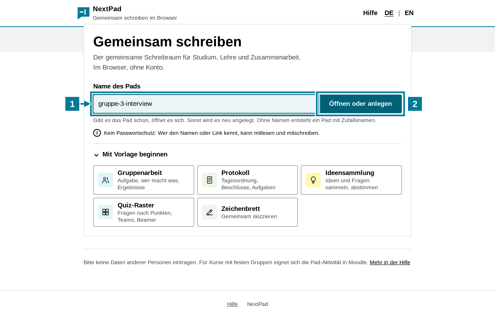
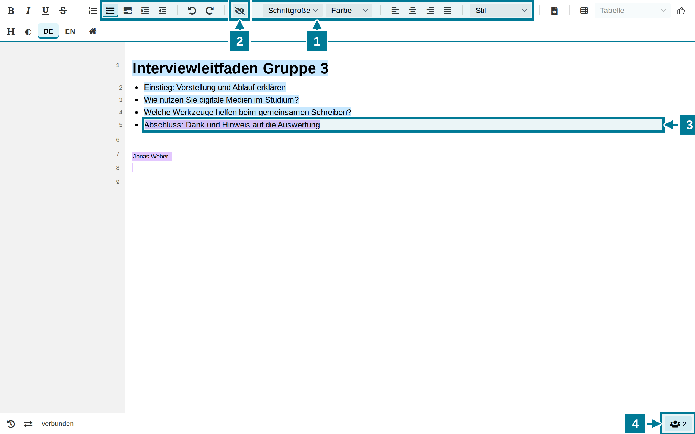
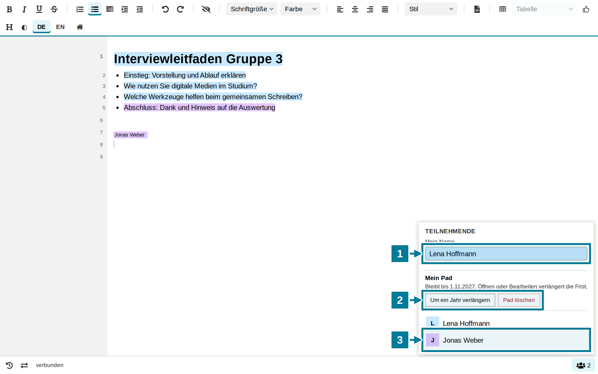
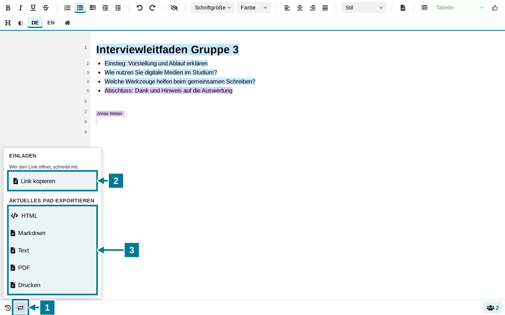

# Ein Pad anlegen

<aside class="np-kasten np-ziel" aria-label="Worum es geht">
<p class="np-kasten-titel">Worum es geht</p>

- ein Pad auf der Startseite anlegen
- gemeinsam darin schreiben und sehen, wer was geschrieben hat
- den eigenen Namen eintragen
- den Link teilen und das Ergebnis sichern

</aside>

Ein Pad ist ein Text, an dem mehrere Personen gleichzeitig schreiben. Alle sehen die Änderungen der anderen sofort. Ein Konto braucht niemand.

## Pad anlegen

<figure class="np-bild">

<figcaption>Ein Name genügt: Gibt es das Pad noch nicht, entsteht es neu.</figcaption>
</figure>

1. Auf der Startseite unter **Name des Pads** einen Namen eintragen, etwa `gruppe-3-interview`. Erlaubt sind Buchstaben, Ziffern, Leerzeichen und die Zeichen `- _ . ( ) ,`, bis 50 Zeichen.
2. **Öffnen oder anlegen** wählen. Gibt es das Pad schon, öffnet es sich. Sonst legt NextPad ein neues, leeres Pad an.

Gleicher Name bedeutet gleiches Pad. Ohne Namen entsteht ein Pad mit Zufallsnamen. Die Vorlagen unter **Mit Vorlage beginnen** bringen eine Gliederung für Gruppenarbeit oder Protokoll mit.

## Gemeinsam schreiben

<figure class="np-bild">

<figcaption>Jede Person schreibt in ihrer Farbe. Das Namensschild zeigt, wo jemand gerade schreibt.</figcaption>
</figure>

1. Die **Werkzeugleiste** formatiert den Text: Listen, Einrücken, Rückgängig, Schriftgröße, Farbe, Ausrichtung und unter **Stil** Überschriften.
2. Das **Auge** blendet die Autorenfarben aus und wieder ein.
3. Was eine andere Person schreibt, erscheint sofort in ihrer Farbe. Hier hat Jonas Weber den letzten Punkt ergänzt.
4. Die Zahl unten rechts zeigt, wie viele gerade im Pad sind.

## Eigenen Namen eintragen

<figure class="np-bild">

<figcaption>Unter „Teilnehmende“ stehen der eigene Name und alle, die gerade im Pad sind.</figcaption>
</figure>

1. Unten rechts auf die Zahl tippen und unter **Mein Name** den eigenen Namen eintragen. Ohne Namen heißt man „Gast“.
2. Wer das Pad angelegt hat, sieht hier **Mein Pad**: wie lange es bleibt, **Um ein Jahr verlängern** und **Pad löschen**.
3. Darunter stehen alle, die gerade im Pad sind, mit ihrer Farbe.

## Teilen und sichern

<figure class="np-bild">

<figcaption>Wer den Link öffnet, schreibt mit. Das Ergebnis lässt sich in fünf Formaten sichern.</figcaption>
</figure>

1. Unten links **Teilen und exportieren** öffnen.
2. **Link kopieren** wählen und den Link weitergeben, etwa im Chat einer Videokonferenz oder in einer Mail an die Gruppe. Auf dem Telefon gibt es zusätzlich **Über das Gerät teilen**.
3. Unter **Aktuelles Pad exportieren** den Text als HTML, Markdown, reinen Text oder PDF sichern oder drucken.

## Gut zu wissen

- Pads von der Startseite haben keinen Passwortschutz. Wer den Namen oder den Link kennt, kann mitlesen und mitschreiben. Ein Name, der sich nicht leicht erraten lässt, etwa mit Kurs und Datum, hält Fremde fern. Namen und andere persönliche Daten Dritter gehören nicht in ein solches Pad.
- Für Kurse mit festen Gruppen eignet sich das Pad als Aktivität in [Moodle](../moodle/index.html) oder [ILIAS](../ilias/index.html). Dann kommen nur Kursmitglieder hinein.
- Das Pad gehört dem Browser, in dem es angelegt wurde. Nur dort erscheinen **Mein Pad**, die Verlängerung und das Löschen.
- Wie lange ein Pad bleibt, legt der Betrieb fest. Öffnen oder Bearbeiten verlängert die Frist.
- Unten links zeigt **Frühere Stände ansehen**, wie der Text entstanden ist. Wer das Pad angelegt hat, kann einen früheren Stand zurückholen.

## Selbst ausprobieren

Ein Pad mit einem eigenen Namen anlegen und den eigenen Namen eintragen. Dann den Link kopieren, in einem zweiten Browser oder auf dem Handy öffnen und dort eine Zeile schreiben. Beide Fenster zeigen die Zeile sofort, jede in ihrer Farbe.

```text
Interviewleitfaden Gruppe 3
```
