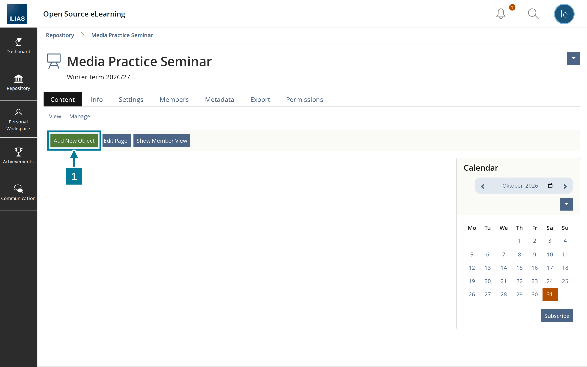
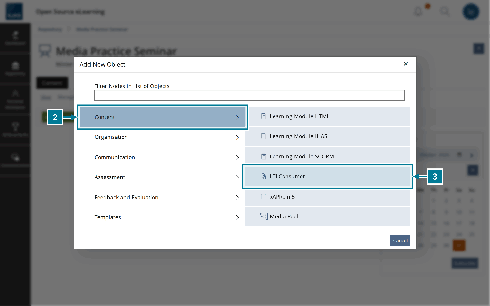
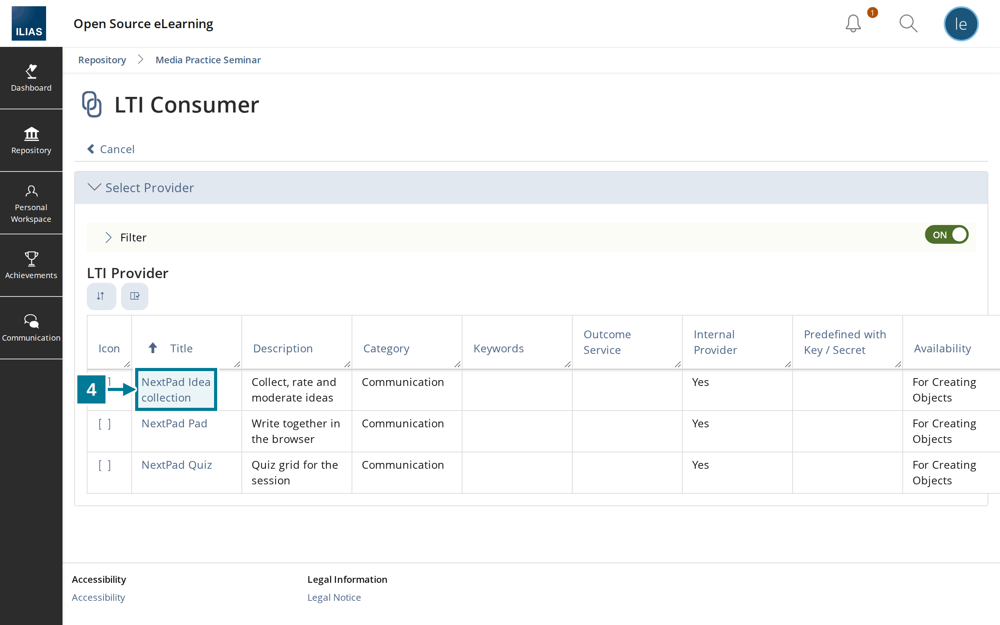
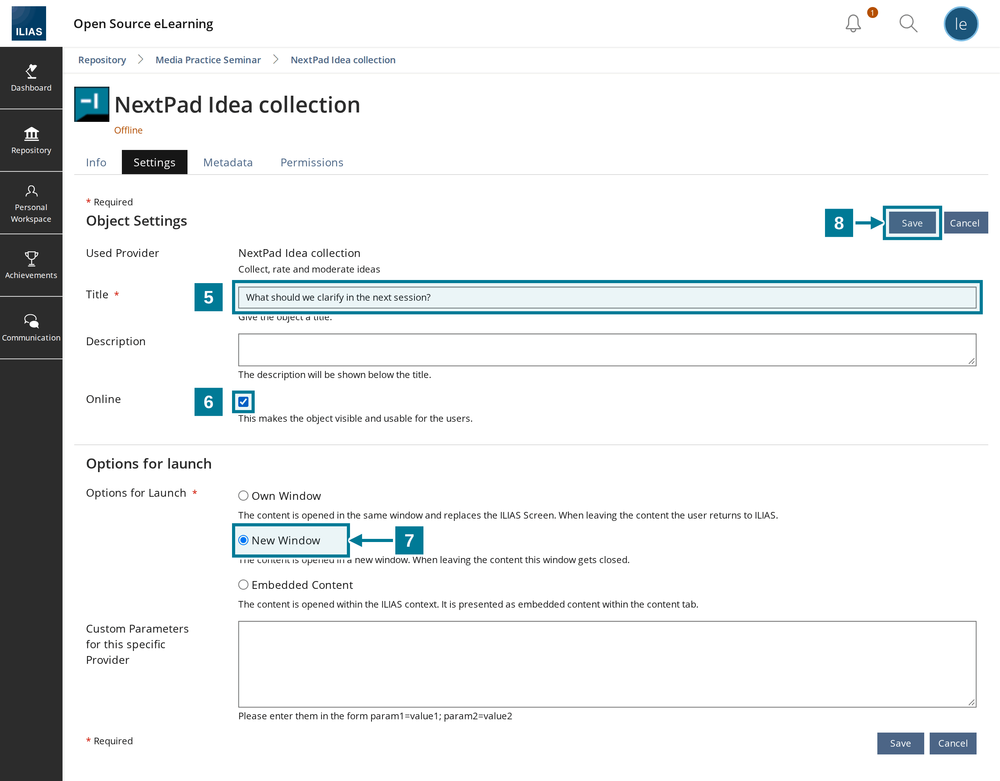
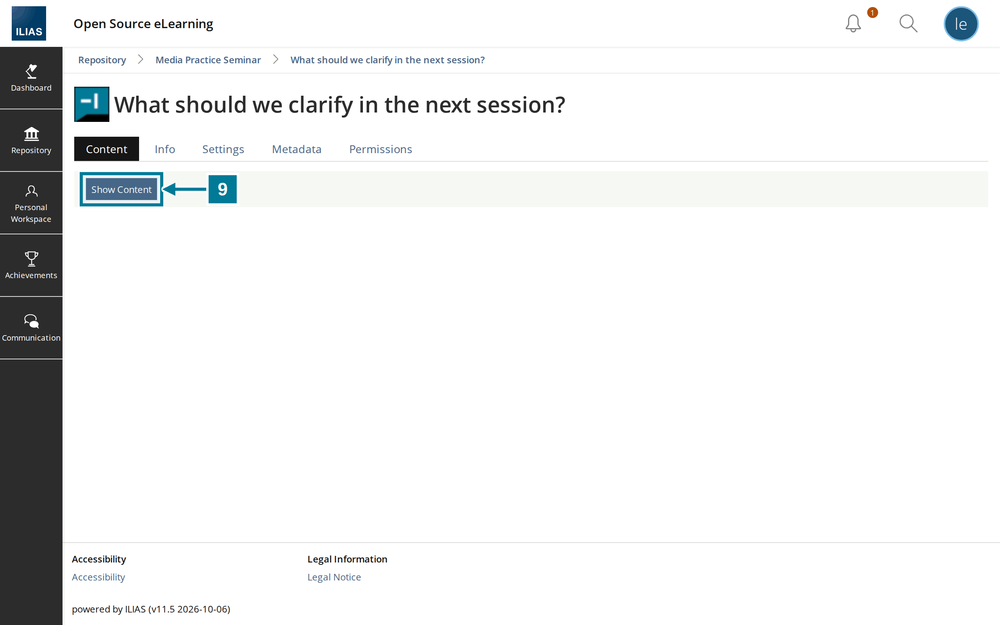
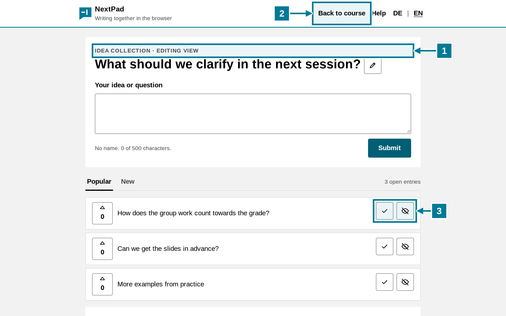
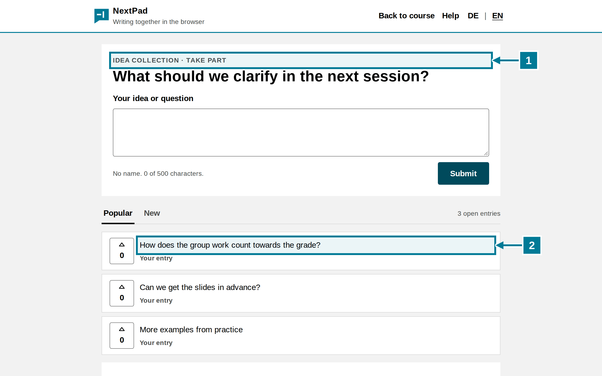

# Add an object to a course

<aside class="np-kasten np-ziel" aria-label="What this is about">
<p class="np-kasten-titel">What this is about</p>

- add a NextPad idea collection to the course as an object
- set the question through the object title
- start and moderate the object

</aside>

Requirement: the administration has registered the NextPad tools in ILIAS. If they are missing from the list, see [Register the tool in ILIAS](setup.md).

## Steps

<figure class="np-bild">

<figcaption>Add a new object in the course.</figcaption>
</figure>

1. Choose **Add New Object** in the course.

<figure class="np-bild">

<figcaption>NextPad sits in the object type “LTI Consumer”.</figcaption>
</figure>

<ol start="2">
<li>Choose the group <strong>Content</strong> on the left.</li>
<li>Choose <strong>LTI Consumer</strong> on the right.</li>
</ol>

<figure class="np-bild">

<figcaption>The list shows the three NextPad tools.</figcaption>
</figure>

<ol start="4">
<li>Click <strong>NextPad Idea collection</strong>. A quiz works the same with <strong>NextPad Quiz</strong>, a shared text with <strong>NextPad Pad</strong>. ILIAS creates the object straight away and opens its settings.</li>
</ol>

<figure class="np-bild">

<figcaption>The title becomes the question of the collection, “Online” makes the object visible.</figcaption>
</figure>

<ol start="5">
<li>Enter the question of the collection under <strong>Title</strong>. NextPad takes up to 200 characters.</li>
<li>Tick <strong>Online</strong>. New objects are hidden from course members otherwise.</li>
<li>Keep <strong>New Window</strong>.</li>
<li>Choose <strong>Save</strong>.</li>
</ol>

<figure class="np-bild">

<figcaption>“Show Content” opens NextPad in a new window.</figcaption>
</figure>

<ol start="9">
<li>Click the object in the course and choose <strong>Show Content</strong>. NextPad opens in a new window.</li>
</ol>

## What the lead sees

<figure class="np-bild">

<figcaption>The lead sees the editing view with the moderation buttons.</figcaption>
</figure>

1. **Editing view** appears above the question. Course administrators and course tutors may moderate.
2. **Back to course** leads to the course page in ILIAS.
3. The tick marks an entry as done, the eye hides it. More in [Collect and moderate](../ideas/collect.md).

## What students see

<figure class="np-bild">

<figcaption>Course members see the same collection to take part, without moderation buttons.</figcaption>
</figure>

1. **Take part** appears above the question.
2. Own entries carry the note “Your entry”. Everyone else sees them without a name.

## Good to know

- NextPad takes the question when the object starts for the first time. If the title changes in ILIAS later, the question stays. It can be changed in NextPad with the pencil.
- The QR code on the board leads to the object in ILIAS. Whoever scans it signs in to ILIAS and chooses **Show Content** there. Guests without an ILIAS account cannot get in.
- Each object has its own collection. A copy of the object starts empty.
- A course collection cannot be deleted from within NextPad. It is not subject to any NextPad deletion period either.

## Try it yourself

Create an idea collection with the question from the pictures in a course and start it. Then write an entry with a test account that is a course member and compare both views. The member view in ILIAS is not enough for this: whoever has started the object once as lead stays lead in NextPad.

```text
What should we clarify in the next session?
```
