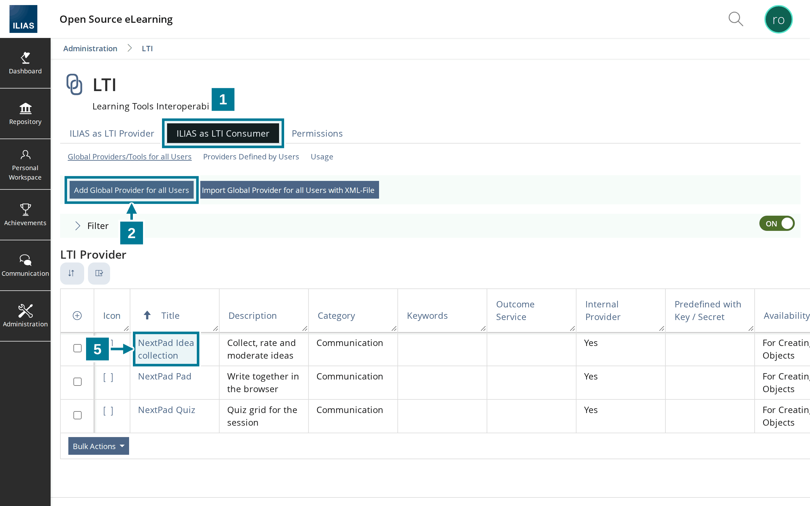
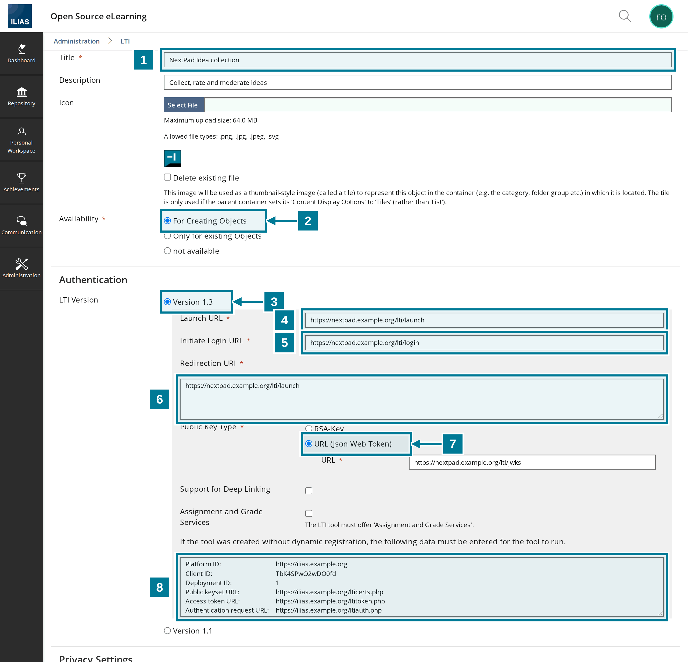
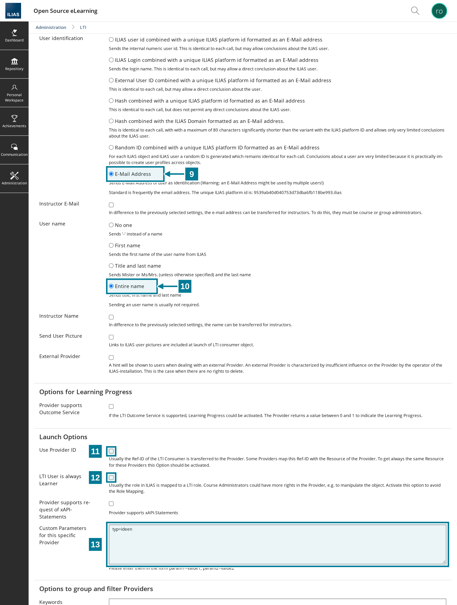

# Register the tool in ILIAS

<aside class="np-kasten np-ziel" aria-label="What this is about">
<p class="np-kasten-titel">What this is about</p>

- register NextPad in ILIAS as a global LTI provider with LTI 1.3
- offer pad, idea collection and quiz as separate tools
- make ILIAS known in the NextPad configuration

</aside>

This guide is meant for the administration of the ILIAS installation and for whoever runs NextPad. Both sides need HTTPS. Below, `https://nextpad.example.org` stands for the NextPad address and `https://ilias.example.org` for the ILIAS address.

Each kind gets its own tool. Teachers then simply pick **NextPad Idea collection**, **NextPad Quiz** or **NextPad Pad** and have nothing to type.

## Steps in ILIAS

<figure class="np-bild">

<figcaption>Under “ILIAS as LTI Consumer” one global provider is created per kind.</figcaption>
</figure>

1. Open **Administration › Extending ILIAS › LTI** and choose the tab **ILIAS as LTI Consumer**.
2. Choose **Add Global Provider for all Users**.
3. Fill in the form as in the table below and save it.
4. Repeat steps 2 and 3 for the other kinds, each with its own title and its own value for `typ`.
5. Open a saved provider again through its title. The hints field now lists the values for NextPad.

## The fields

<figure class="np-bild">

<figcaption>Upper part: NextPad addresses and the hints for NextPad.</figcaption>
</figure>

<figure class="np-bild">

<figcaption>Lower part: name and email address, launch options and the parameter.</figcaption>
</figure>

| No. | Field | Value |
|---|---|---|
| 1 | Title | as teachers should read it in the list, for example `NextPad Idea collection` |
| 2 | Availability | For Creating Objects |
| 3 | LTI Version | Version 1.3 |
| 4 | Launch URL | `https://nextpad.example.org/lti/launch` |
| 5 | Initiate Login URL | `https://nextpad.example.org/lti/login` |
| 6 | Redirection URI | `https://nextpad.example.org/lti/launch` |
| 7 | Public Key Type | URL (Json Web Token), below it `https://nextpad.example.org/lti/jwks` |
| 8 | Hints | appear only after saving; the values belong in the NextPad configuration |
| 9 | User identification | E-Mail Address |
| 10 | User name | Entire name |
| 11 | Use Provider ID | leave unticked |
| 12 | LTI User is always Learner | leave unticked |
| 13 | Custom Parameters for this specific Provider | `typ=ideen`, for the quiz `typ=quiz`, for the pad `typ=pad` |

The parameter values `ideen`, `quiz` and `pad` stay the same in every language. The NextPad mark suits the **Icon**, “Communication” the **Category**. Both are optional.

With **Use Provider ID** all objects of a course would share one collection. With **LTI User is always Learner** ILIAS would send no roles to NextPad, and nobody could moderate.

## Step in NextPad

NextPad only accepts launches from platforms listed in the platform file `lti-platforms.json`. Each tool gets an entry there with the values from the hints field:

```json
{
  "name": "ilias-ideas",
  "label": "Sign in with ILIAS",
  "issuer": "https://ilias.example.org",
  "client_id": "AbC123xYz456QrS",
  "deployment_ids": ["1"],
  "auth_url": "https://ilias.example.org/ltiauth.php",
  "jwks_url": "https://ilias.example.org/lticerts.php"
}
```

`issuer` is the Platform ID, `auth_url` the Authentication request URL and `jwks_url` the Public keyset URL. Client ID and Deployment ID differ per tool. The [server documentation](https://github.com/NextPad/NextPad/blob/main/server/README.md) describes all fields of the file. NextPad must restart after the file changes.

## Good to know

- ILIAS passes name and language on to NextPad. NextPad needs the email address for the notice before deleting one's own free pads and to recognise admins from `NEXTPAD_ADMINS`. The other kinds of user identification send a substitute address such as `…@….ilias` that no mail reaches.
- Course administrators and course tutors may moderate, in groups the group administrators, as well as the ILIAS administration. Everyone else takes part. If the object sits in a group, the group roles count, not those of the course.
- In a new window NextPad has the full width, and the board is easier to drag onto the projector.
- When ILIAS changes its keys, NextPad fetches the new ones through `jwks_url` by itself.
