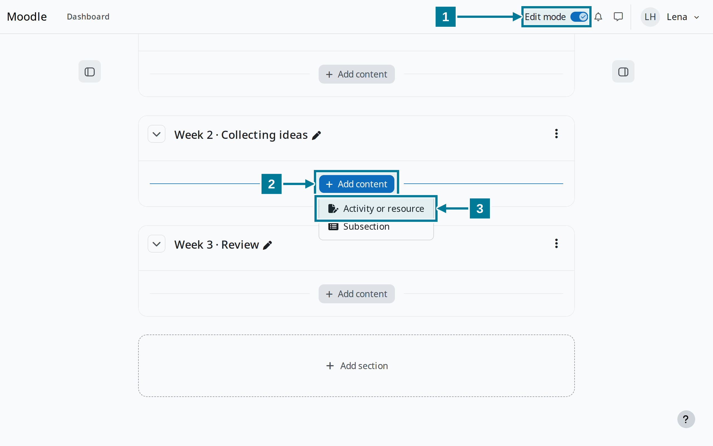
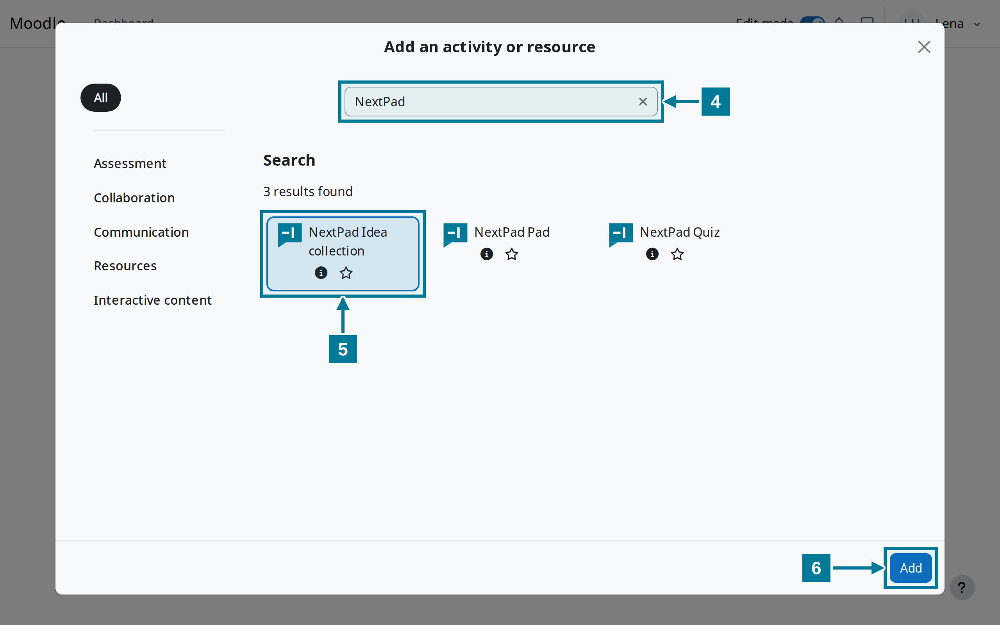
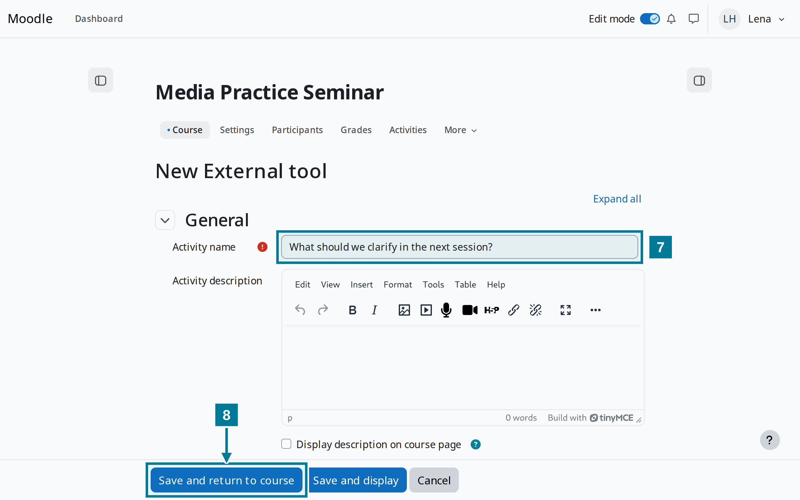
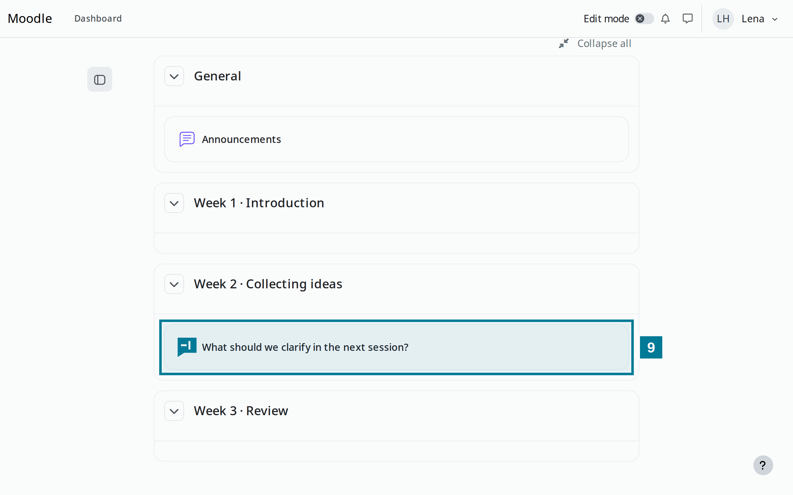
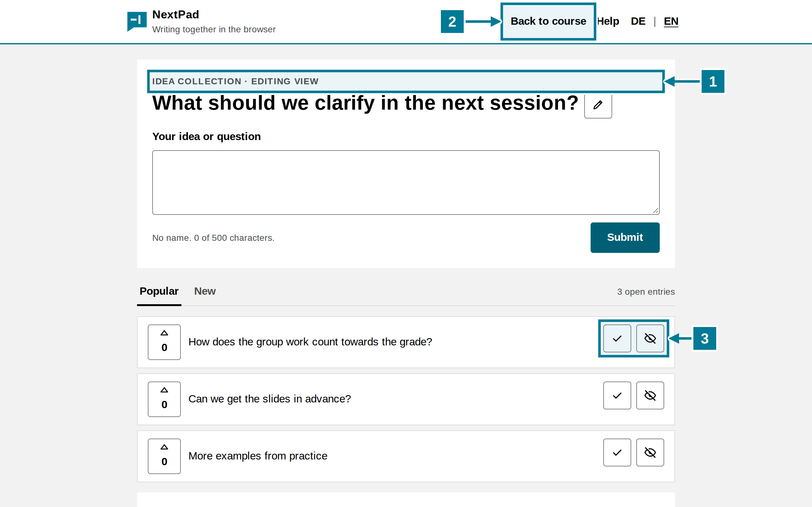
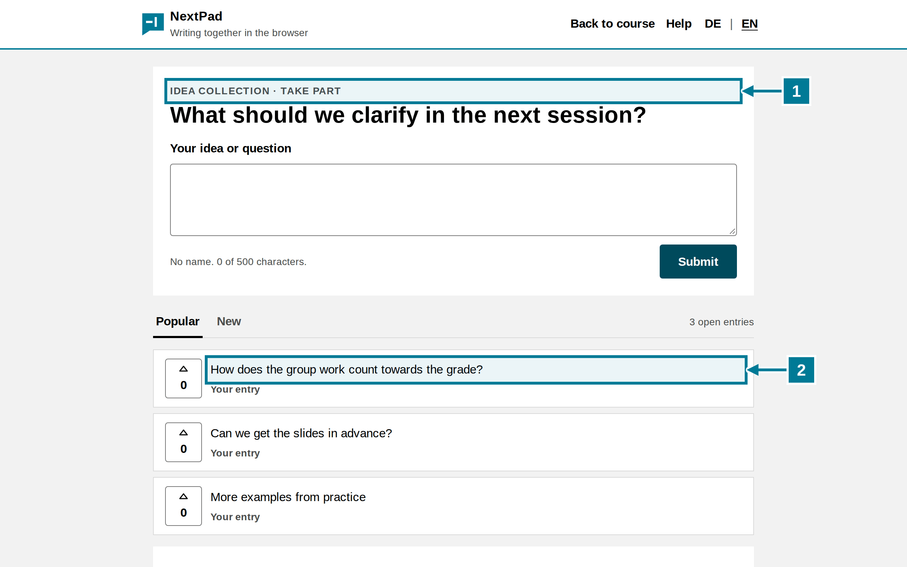

# Add an activity to a course

<aside class="np-kasten np-ziel" aria-label="What this is about">
<p class="np-kasten-titel">What this is about</p>

- add a NextPad idea collection to the course as an activity
- set the question through the activity name
- start and moderate the activity

</aside>

Requirement: the administration has registered the NextPad tools in Moodle. If they are missing from the activity chooser, see [Register the tool in Moodle](setup.md).

## Steps

<figure class="np-bild">

<figcaption>Turn on edit mode and add an activity in the right section.</figcaption>
</figure>

1. Turn on **Edit mode** at the top right of the course.
2. Choose **Add content** in the right section.
3. Choose **Activity or resource**.

<figure class="np-bild">

<figcaption>The search shows the three NextPad tools.</figcaption>
</figure>

<ol start="4">
<li>Type <strong>NextPad</strong> into the search.</li>
<li>Choose <strong>NextPad Idea collection</strong>. A quiz works the same with <strong>NextPad Quiz</strong>, a shared text with <strong>NextPad Pad</strong>.</li>
<li>Choose <strong>Add</strong>.</li>
</ol>

<figure class="np-bild">

<figcaption>The activity name becomes the question of the collection.</figcaption>
</figure>

<ol start="7">
<li>Enter the question of the collection under <strong>Activity name</strong>. NextPad takes up to 200 characters.</li>
<li>Choose <strong>Save and return to course</strong>.</li>
</ol>

<figure class="np-bild">

<figcaption>The activity sits in the course and opens NextPad in a new window.</figcaption>
</figure>

<ol start="9">
<li>Click the activity in the course. NextPad opens in a new window.</li>
</ol>

## What the lead sees

<figure class="np-bild">

<figcaption>The lead sees the editing view with the moderation buttons.</figcaption>
</figure>

1. **Editing view** appears above the question. All teachers of the course may moderate.
2. **Back to course** leads to the course page in Moodle.
3. The tick marks an entry as done, the eye hides it. More in [Collect and moderate](../ideas/collect.md).

## What students see

<figure class="np-bild">

<figcaption>Students see the same collection to take part, without moderation buttons.</figcaption>
</figure>

1. **Take part** appears above the question.
2. Own entries carry the note “Your entry”. Everyone else sees them without a name.

## Good to know

- NextPad takes the question when the activity starts for the first time. If the name changes in Moodle later, the question stays. It can be changed in NextPad with the pencil.
- The QR code on the board leads to the activity in Moodle. Whoever scans it signs in to Moodle and then lands in the collection. Guests without a Moodle account cannot get in.
- Each activity has its own collection. A copy of the activity in another course starts empty.
- A course collection cannot be deleted from within NextPad. It is not subject to any NextPad deletion period either.

## Try it yourself

Create an idea collection with the question from the pictures in a course and start it. Then write an entry with a student test account and compare both views. Switching roles in Moodle is not enough for this: whoever has started the activity once as lead stays lead in NextPad.

```text
What should we clarify in the next session?
```
