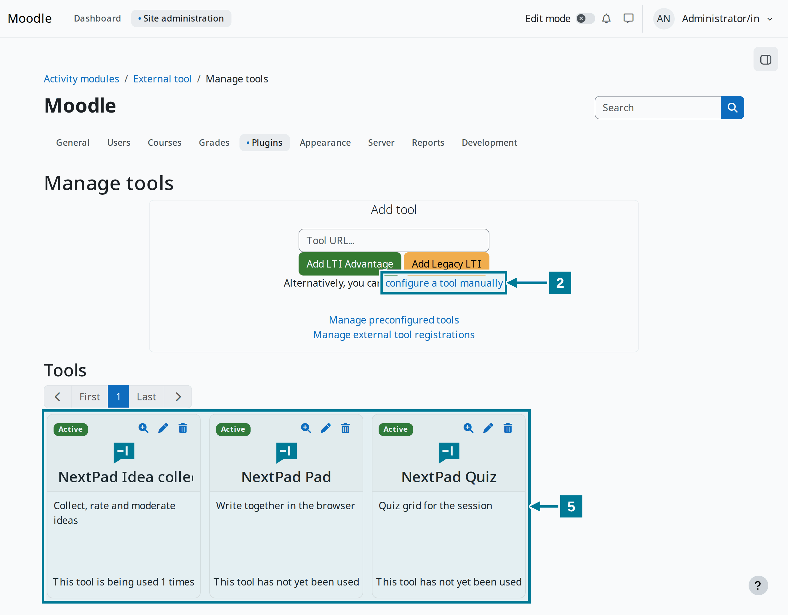
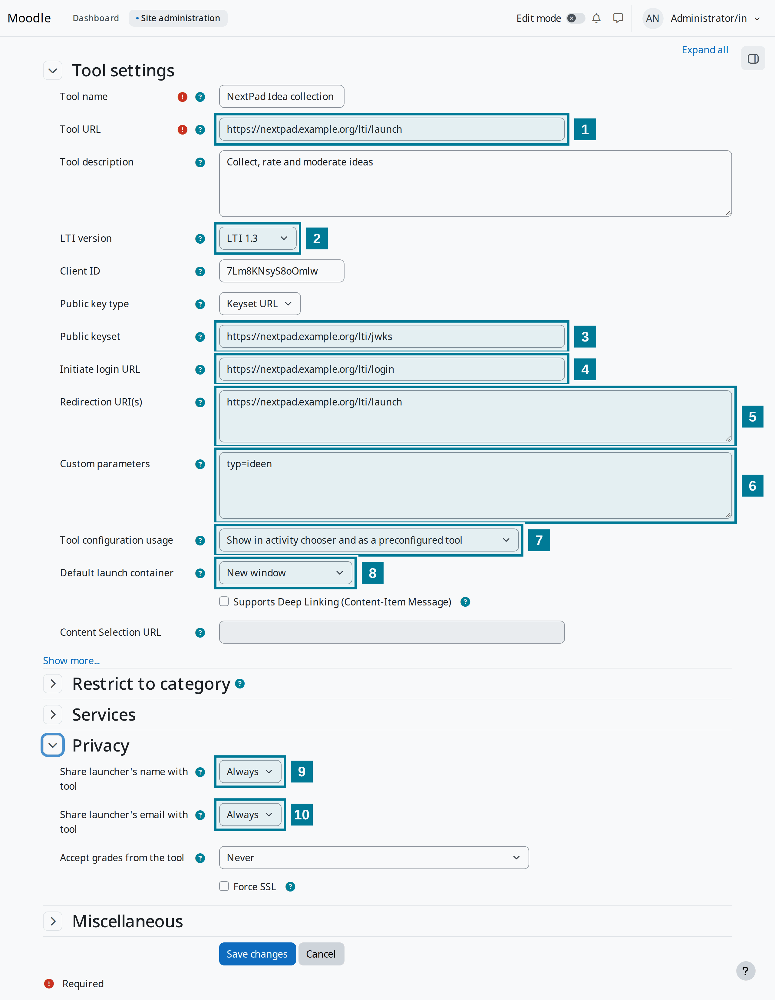

# Register the tool in Moodle

<aside class="np-kasten np-ziel" aria-label="What this is about">

What this is about

- register NextPad in Moodle as an external tool with LTI 1.3
- offer pad, idea collection and quiz as separate tools in the activity chooser
- make Moodle known in the NextPad configuration

</aside>

This guide is meant for the Moodle administration and for whoever runs NextPad. Both sides need HTTPS. Below, `https://nextpad.example.org` stands for the NextPad address.

Each kind gets its own tool. Teachers then simply pick **NextPad Idea collection**, **NextPad Quiz** or **NextPad Pad** in the activity chooser and have nothing to type.

## Steps in Moodle

<figure class="np-bild">

<figcaption>Under “Manage tools” one tool is created per kind.</figcaption>
</figure>

1. Open **Site administration › Plugins › Activity modules › External tool › Manage tools**.
2. Choose **configure a tool manually**.
3. Fill in the form as in the table below and choose **Save changes**.
4. Repeat steps 2 and 3 for the other kinds, each with its own name and its own value for `typ`.
5. The tools appear as cards under **Tools**. The magnifier on a card shows the client ID and the deployment ID. Both belong in the NextPad configuration.

## The fields

<figure class="np-bild">

<figcaption>The numbers in the picture match the rows of the table.</figcaption>
</figure>

| No. | Field | Value |
|---|---|---|
| | Tool name | as teachers should read it in the chooser, for example `NextPad Idea collection` |
| 1 | Tool URL | `https://nextpad.example.org/lti/launch` |
| 2 | LTI version | LTI 1.3 |
| 3 | Public keyset | `https://nextpad.example.org/lti/jwks` (key type: Keyset URL) |
| 4 | Initiate login URL | `https://nextpad.example.org/lti/login` |
| 5 | Redirection URI(s) | `https://nextpad.example.org/lti/launch` |
| 6 | Custom parameters | `typ=ideen`, for the quiz `typ=quiz`, for the pad `typ=pad` |
| 7 | Tool configuration usage | Show in activity chooser and as a preconfigured tool |
| 8 | Default launch container | New window |
| 9 | Share launcher's name with tool | Always |
| 10 | Share launcher's email with tool | Always |

The parameter values `ideen`, `quiz` and `pad` stay the same in every language.

Under **Show more** `https://nextpad.example.org/static/logo.svg` can be entered as **Icon URL**. The activity chooser then shows the NextPad mark instead of a puzzle piece.

## Step in NextPad

NextPad only accepts launches from Moodle sites listed in the platform file `lti-platforms.json`. Each tool gets an entry there with its client ID and its deployment ID. The [server documentation](https://github.com/NextPad/NextPad/blob/main/server/README.md) describes the structure and fields of the file. NextPad must restart after the file changes.

## Good to know

- Moodle passes name and language on to NextPad. NextPad needs the email address for the notice before deleting one's own free pads and to recognise admins from `NEXTPAD_ADMINS`.
- In NextPad everyone with the Moodle capability `mod/lti:manage` may moderate. By default these are editing and non-editing teachers and the manager role.
- The activity also runs embedded in the Moodle page. In a new window it has the full width though, and the board is easier to drag onto the projector.
- When Moodle changes its keys, NextPad fetches the new ones by itself if the platform file holds a key address. With a key file, the file must be renewed.
