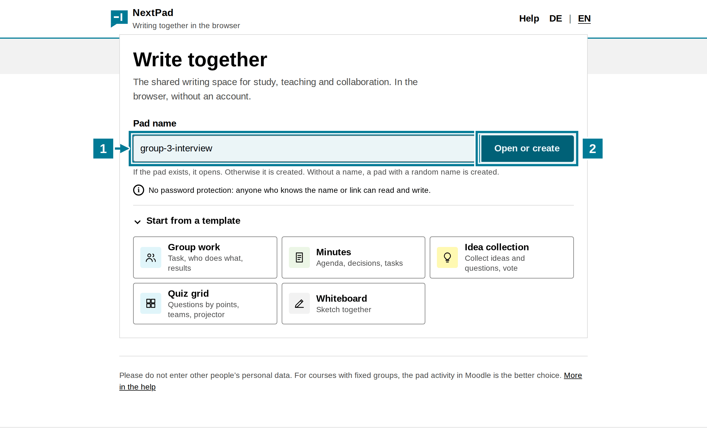
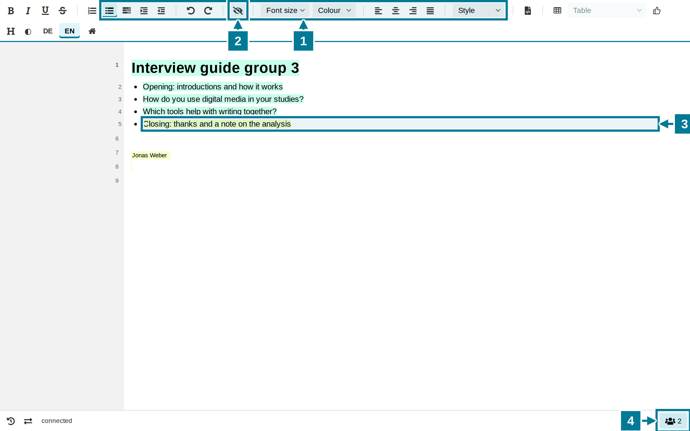
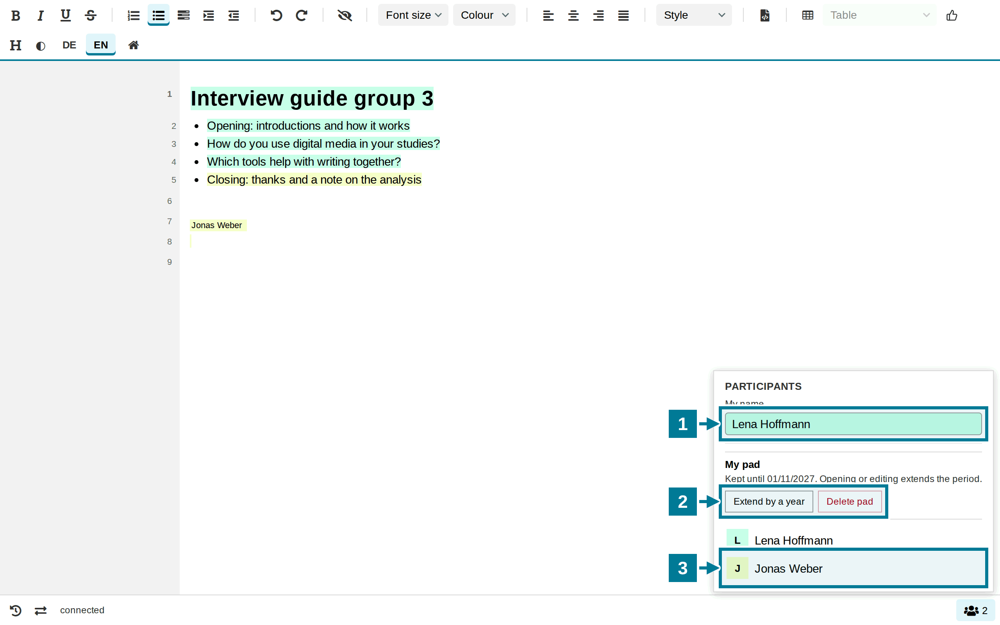
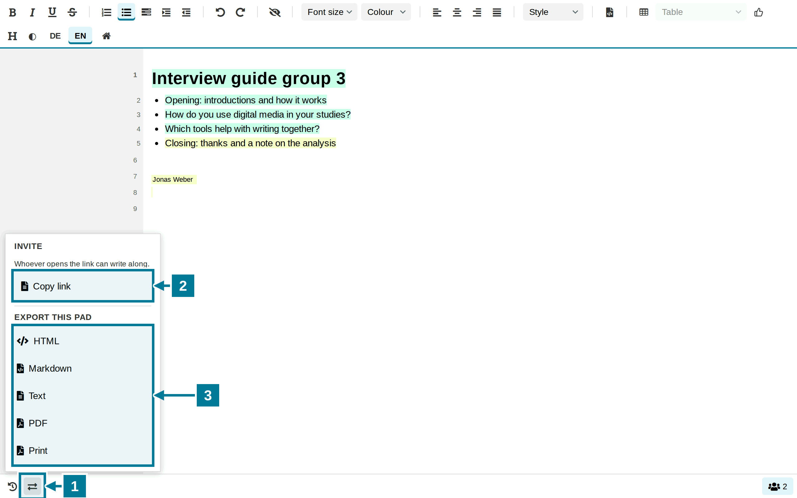

# Create a pad

<aside class="np-kasten np-ziel" aria-label="What this is about">
<p class="np-kasten-titel">What this is about</p>

- create a pad on the start page
- write in it together and see who wrote what
- enter one's own name
- share the link and save the result

</aside>

A pad is a text that several people write at the same time. Everyone sees the changes of the others at once. Nobody needs an account.

## Create a pad

<figure class="np-bild">

<figcaption>A name is enough: if the pad does not exist yet, it is created.</figcaption>
</figure>

1. On the start page, enter a name under **Pad name**, for example `group-3-interview`. Letters, digits, spaces and the characters `- _ . ( ) ,` are allowed, up to 50 characters. The same name means the same pad: whoever enters the same name ends up in the same text.
2. Choose **Open or create**. If the pad exists, it opens. Otherwise NextPad creates a new, empty pad.

Without a name, a pad with a random name is created. The templates under **Start from a template** come with an outline for group work or minutes.

## Write together

<figure class="np-bild">

<figcaption>Each person writes in their own colour. The name tag shows where someone is writing.</figcaption>
</figure>

1. The **toolbar** formats the text: lists, indent, undo, font size, colour, alignment and headings under **Style**.
2. The **eye** hides and shows the author colours.
3. What another person writes appears at once in their colour. Here Jonas Weber added the last point.
4. The number at the bottom right shows how many people are in the pad.

## Enter one's own name

<figure class="np-bild">

<figcaption>“Participants” holds one's own name and everyone who is in the pad.</figcaption>
</figure>

1. Tap the number at the bottom right and enter one's own name under **My name**.
2. Whoever created the pad sees **My pad** here: how long it is kept, **Extend by a year** and **Delete pad**.
3. Below are all people in the pad, with their colour.

## Share and save

<figure class="np-bild">

<figcaption>Whoever opens the link writes along. The result can be saved in five formats.</figcaption>
</figure>

1. Open **Share and export** at the bottom left.
2. Choose **Copy link** and pass the link on, for example in the chat of a video conference or in an email to the group. On a phone there is also **Share via device**.
3. Under **Export this pad**, save the text as HTML, Markdown, plain text or PDF, or print it.

## Good to know

- Pads from the start page have no password protection. Anyone who knows the name or the link can read and write. A name that is hard to guess, for example with course and date, keeps strangers out. Names and other personal data of third parties do not belong in such a pad.
- For courses with fixed groups, the pad as an activity in [Moodle](../moodle/index.html) or [ILIAS](../ilias/index.html) is the better choice. Then only course members get in.
- The pad belongs to the browser it was created in. **My pad**, extending and deleting appear only there.
- How long a pad is kept is set by whoever runs NextPad. Opening or editing extends the period.
- **View earlier versions** at the bottom left shows how the text came about. Whoever created the pad can bring back an earlier version.

## Try it yourself

Create a pad with a name of one's own and enter one's own name. Then copy the link, open it in a second browser or on a phone and write a line there. Both windows show the line at once, each in its own colour.

```text
Interview guide group 3
```
